# 项目核心流程图

## v3.8 单Agent模块迭代与发布包门禁

读图说明：不再依赖A/B/C队列或子智能体，由同一Agent集成模块后提交云端。新增发布资源和未签名device包检查与原147项/36图并存；任何必选失败均继续修复，而不是宣布发布完成。

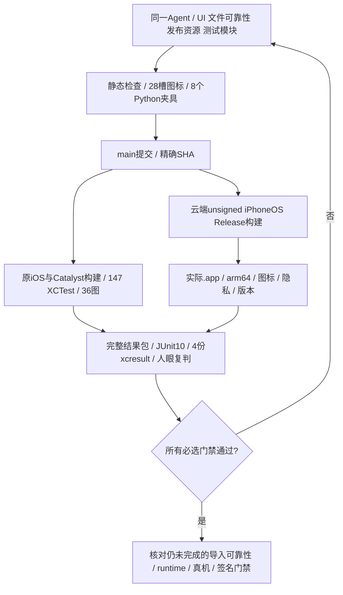

## v3.7 iPhone 单头界面与云端门禁

读图说明：根窄屏 chrome 保留零高槽位，聊天自己呈现唯一集成头部，其他页面直接显示标题与内容；四页身份不变。隐藏聊天同步关闭模态，历史关闭后仍受活动态焦点门禁约束。用户允许按文件分工并行，但所有编译、运行与图片验证仍在云端，最新结果包不通过就退回修复。

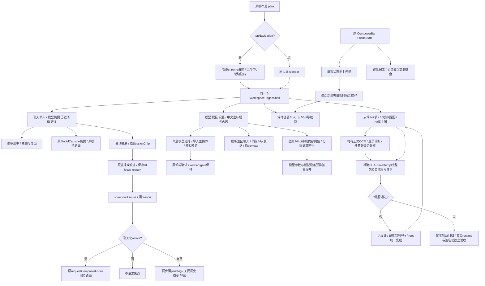

本文是 `md/flow/flow.md` 的 Mermaid 可视化版本。每张图前先给人工读图说明，图中节点使用中文注释，方便快速理解当前真实逻辑。

## 1. App 启动与全局状态

读图说明：这张图展示 App 启动时如何创建状态对象、扫描本地模型文件，并把状态注入 SwiftUI 界面。重点看 `ModelCatalog` 如何成为模型和 artifact 状态的入口。

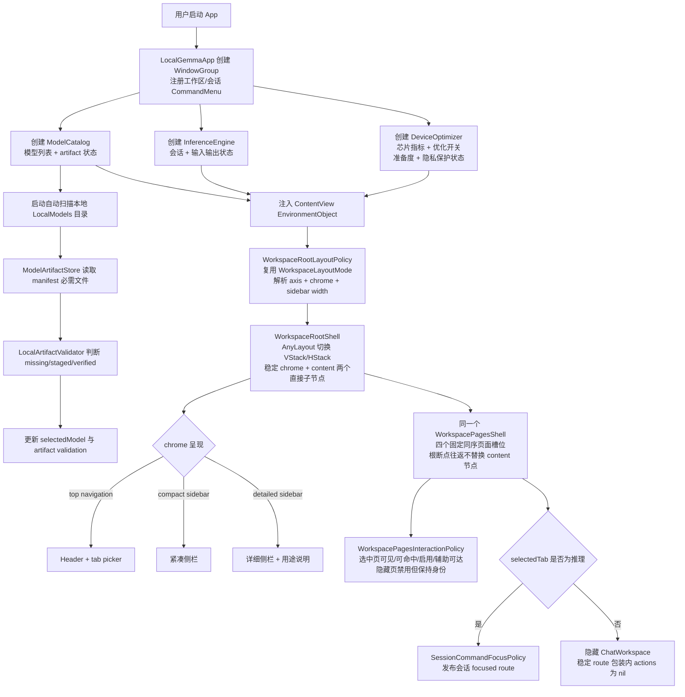

## 2. 模型 artifact 校验流

读图说明：这张图展示本项目最重要的安全边界。模型文件存在不等于可真实运行，只有 concrete SHA-256 匹配后才进入 verified。

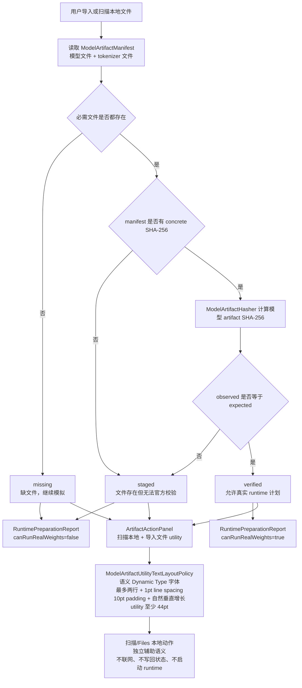

## 3. 模型卸载确认流

读图说明：这张图展示模型页破坏性卸载动作的确认边界。点击卸载只打开确认弹层；取消不会改文件或部署状态；确认后才进入 `ModelCatalog` 删除 App 托管 artifact/tokenizer 并停止部署。

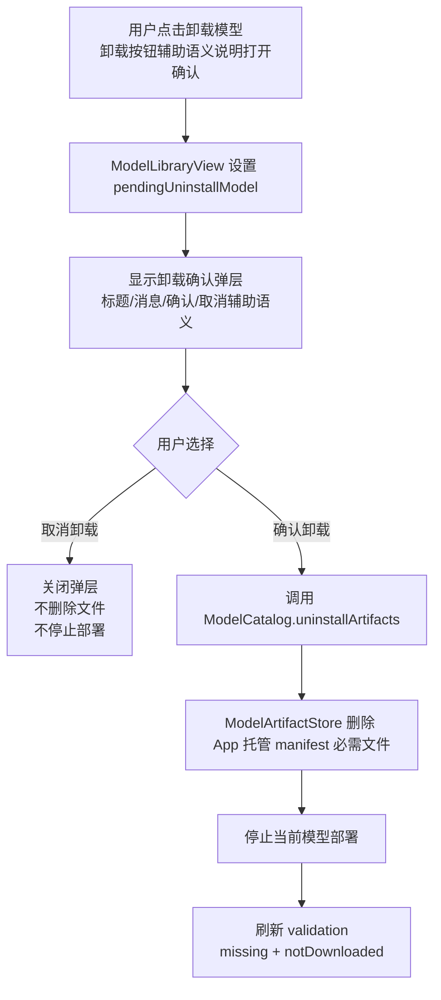

## 4. 推理与会话流

读图说明：这张图展示用户输入如何变成一轮模拟流式回答。当前默认 runtime 是模拟器，不会调用真实权重。

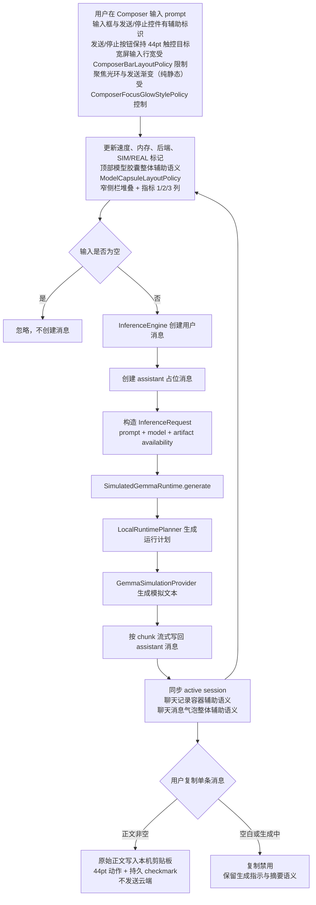

## 5. UI 布局与工作区流

读图说明：这张图展示 `ContentView` 如何把容器尺寸解析成根布局计划，再由生产 `WorkspaceRootShell` 在不替换工作区 content 的前提下切换布局轴与 chrome。iPhone 横屏、iPad 竖屏大画布、Mac Catalyst 和桌面窗口都复用 `WorkspaceLayoutMode` 尺寸断点；所有尺寸始终共享同一个 `WorkspacePagesShell`，四页固定同序存在且没有横向分页手势，只有当前页可交互和辅助可达；shell 直接子节点固定为 chrome、content，跨断点和显式导航时页面局部状态不重建。只有活动聊天页通过 `SessionCommandFocusPolicy` 发布会话 focused route。`WorkbenchVisualStylePolicy`、`AppMotionAccessibilityPolicy`、工作区快捷键、44pt 触控目标、辅助语义、模型文件与 verified 门禁保持既有边界。

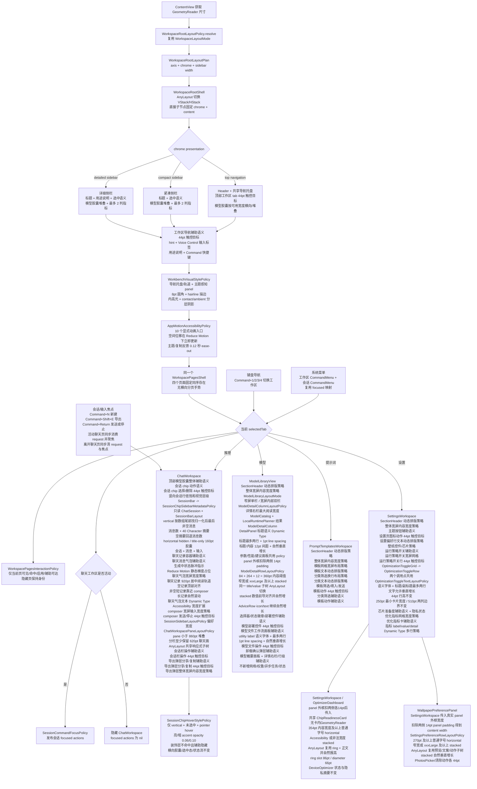

## 6. 相册壁纸流

读图说明：这张图展示从相册选择图片后，项目如何压缩图片再保存为 App 背景，避免大图直接写入 AppStorage；设置页选择相册壁纸和恢复系统背景控件通过辅助语义说明系统背景、相册图片已启用、正在处理和不发送云端服务边界，并共享 44pt 图标动作触控目标。

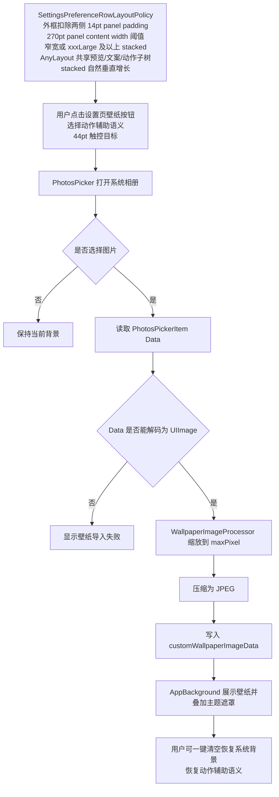

## 7. 会话导出与分享流

读图说明：这张图展示导出时为什么有文件分享和文本分享两条路径。目标是避免分享一个不存在的临时文件，同时让分享与复制动作向辅助技术说明本地 Markdown、文本兜底、剪贴板和不发送云端的边界，并让底部分享/复制与 toolbar 分享入口保持 44pt 触控目标；`ExportSessionView` 的完整正文预览使用语义等宽 Dynamic Type 字体、ScrollView 和文本选择，宽度继续由 `ExportSessionLayoutPolicy` 的 320/760pt 轨道控制。

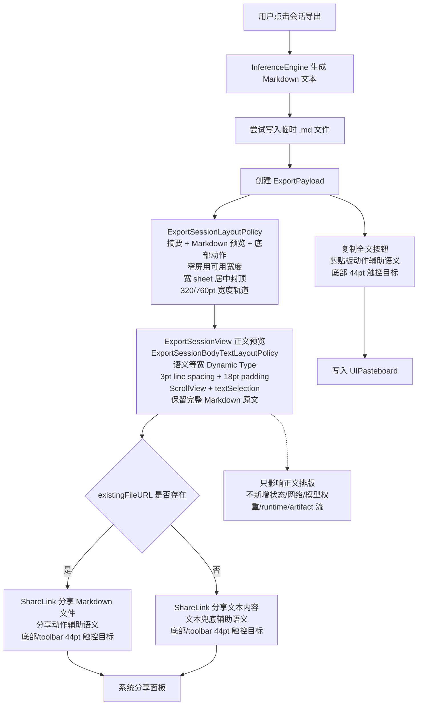

## 7.1 v2.83 顶部模型胶囊与模型 selector badge 流

读图说明：这张图只描述 v2.83 的本地只读 UI 链路。顶部胶囊的 deployment 状态直接来自 `ModelCatalog`，selector 与胶囊使用同一主题感知 badge/style/text 契约；顶部整体摘要和 selector 行级入口的辅助树范围不同。图中没有新增下载、网络或真实推理节点。

```mermaid
flowchart LR
    A[ModelCatalog.selectedModel] --> B[deploymentState(for: selectedModel)]
    C[validation(for: selectedModel)] --> D[artifact availability]
    B --> E[ContentView.headerView]
    E --> F[HeaderView]
    F --> G[ModelCapsule]
    G --> H[Running / Stopped<br/>overall accessibility summary]
    D --> G
    B --> I[ModelSelectorPanel]
    D --> I
    I --> J[StatusBadge<br/>install state]
    I --> K[AvailabilityBadge<br/>missing / staged / verified]
    I --> L[DeploymentBadge<br/>running / stopped]
    J --> M[ModelStatusBadgeStylePolicy<br/>light / dark roles]
    K --> M
    L --> M
    G --> M
    M --> N[ModelStatusBadgeTextLayoutPolicy<br/>Dynamic Type]
    N --> O[ModelStatusBadgeRowLayoutPolicy<br/>220pt / invalid / xxxLarge stacked]
    H -. no download / no real runtime .-> P[Local privacy and verified gate]
    J --> Q[selector independent accessibility]
    K --> Q
    L --> Q
```

## 7.2 v2.85 取消生成占位生命周期流

读图说明：这张图只描述本地模拟生成的空 assistant placeholder 在 active 与 stop 后 cancelled 两个呈现状态之间的差异。stop 不删除消息、不替换 UUID、不重排 session；视觉 indicator 与 VoiceOver value 必须由同一无状态 policy 决定。

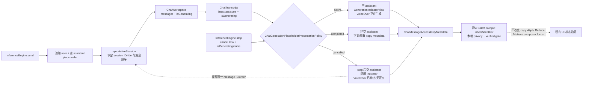

## 7.3 v2.84 模型概要标签与校验摘要动态排版流

读图说明：这张图只描述模型页概要的本地只读排版链路。`validation.summary` 和能力标签来自同一个本地 `model + validation` 输入；policy 只提供静态文字契约，verified 门禁、整体辅助语义和外部动作保持既有边界。

```mermaid
flowchart LR
    A[ModelCatalog.validation(for: selectedModel)] --> B[ModelLibraryView]
    B --> C[ModelDetailColumn]
    C --> D[ModelSummaryPanel<br/>model + validation]
    D --> E[FlowLayout<br/>adaptive minimum 72pt<br/>8pt horizontal/vertical spacing]
    E --> F[能力标签<br/>semantic Dynamic Type<br/>2 lines + 1pt spacing<br/>9/6pt padding + vertical growth<br/>theme.chipSurface<br/>theme.secondaryText<br/>theme.subtleBorder]
    D --> G[validation.summary<br/>semantic Dynamic Type<br/>3 lines + 1pt spacing<br/>vertical growth]
    D --> H[ModelSummaryAccessibilityMetadata<br/>single combined element]
    A --> I{artifact availability}
    I --> J[missing / staged / verified<br/>local display only]
    J --> K[LocalRuntimePlanner verified gate<br/>only verified can run real weights]
    F -. static layout only .-> L[No action / animation / network / weight download]
    G -. static layout only .-> L
```

## 8. main 直推与云端结果包验收流

读图说明：这张图展示新的协作闭环。重点是 Agent B 必须在 `main` 上提交并推送，GitHub Actions 生成带自描述 manifest 的未加密结果包，Agent C 只能验收 `origin/main` 最新 commit 对应的 artifact name、run URL、run id 和 run attempt；失败时通过追加修复 commit 回到同一条主线。

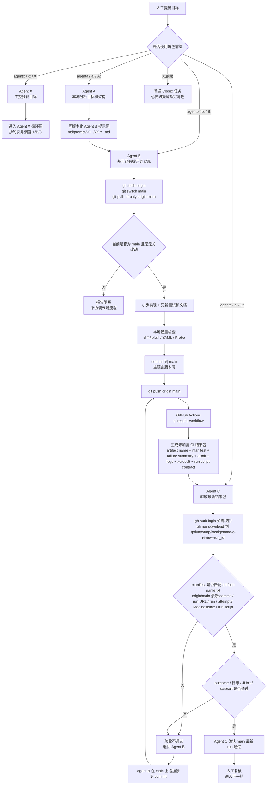

## 9. Agent X 主控循环迭代流

读图说明：这张图展示未来人工用 `agentx`、`x:` 或 `X:` 给出总目标后，Agent X 如何拆分轮次并调度 Agent A、Agent B、GitHub Actions 和 Agent C。重点是 Agent X 只能根据 Agent C 对最新 artifact 的验收结论继续、退回、暂停或完成，不能跳过云端结果包复判。

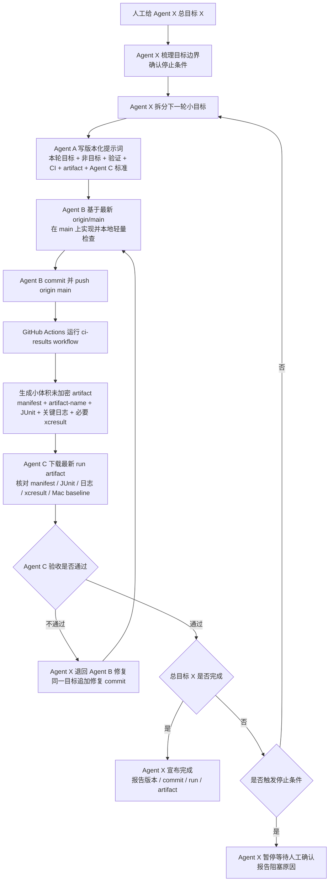

## 10. Mac Catalyst 本地运行入口流

读图说明：这张图展示 v1.0 新增的项目内 Mac Catalyst 本地 build/run 入口。重点是脚本只负责本机构建、启动、日志和调试，不下载模型权重、不调用外部推理服务；云端 CI 只检查脚本静态契约，不尝试启动 GUI App。

```mermaid
flowchart TD
    A[人工或 Agent 执行<br/>./script/build_and_run.sh] --> B{选择脚本模式}
    B -- 默认 run --> C[停止旧 LocalGemma 进程]
    B -- --build-only --> D[只构建 Debug Mac Catalyst App]
    B -- --verify --> C
    B -- --logs / --telemetry --> C
    B -- --debug --> E[lldb 调试入口]
    C --> F[xcodebuild project LocalGemma.xcodeproj<br/>scheme LocalGemma<br/>destination Mac Catalyst]
    D --> F
    F --> G[DerivedData 写入<br/>.build/DerivedDataCodex-MacCatalystRun]
    G --> H[定位 Build/Products 下的 LocalGemma.app]
    H --> I{是否需要启动}
    I -- 否 --> J[输出 app bundle 路径]
    I -- 是 --> K[/usr/bin/open -n 启动 .app]
    K --> L{--verify 是否要求进程检查}
    L -- 是 --> M[pgrep -x LocalGemma<br/>确认进程存在]
    L -- 否 --> N[进入日志流或普通运行]
    M --> O[成功或输出签名/窗口服务/沙箱失败原因]
    E --> F
```

## v3.0 工作台与云端视觉验收

读图说明：共享状态进入拆分后的工作区，截图由云端生产 App 生成，必须核对版本身份后人工查看。

~~~mermaid
flowchart TD
    %% 保留现有状态边界
    State[ModelCatalog / InferenceEngine / DeviceOptimizer] --> Shell[ContentView 稳定页面壳]
    Shell --> Pages[聊天 / 模型 / 提示词 / 设置]
    Theme[WorkbenchTheme / WorkbenchComponents] --> Pages
    %% 单代理与云端验证链路
    Main[main 提交] --> CI[云端 LogicSmoke / iOS XCTest / Catalyst]
    CI --> Visual[iPhone / iPad 四页亮暗截图]
    Visual --> Manifest[SHA / run / attempt / 截图 manifest]
    Manifest --> Review[结果包核对与视觉检查]
~~~


## v3.1 大屏宽度契约

读图说明：收窄后的全局导航和会话分栏使用真实剩余宽度，测试同步生产设计。

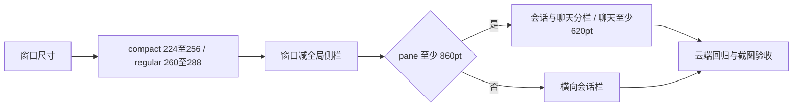


## v3.1 云端验收结果

读图说明：布局回归修复后，最新 main commit 由同一云端 run 完成代码、构建、测试和视觉截图验收。

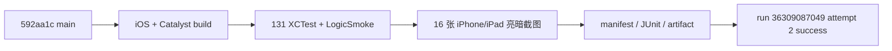


## v3.2 提示词网格

读图说明：模板网格使用真实剩余宽度选择列数，避免宽屏单列空白。

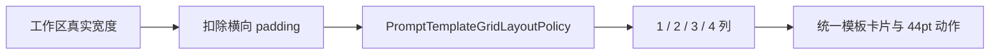


## v3.3 云端截图重试

读图说明：视觉采集只对 simctl 瞬态失败做有界重试，最终错误仍使阶段失败。

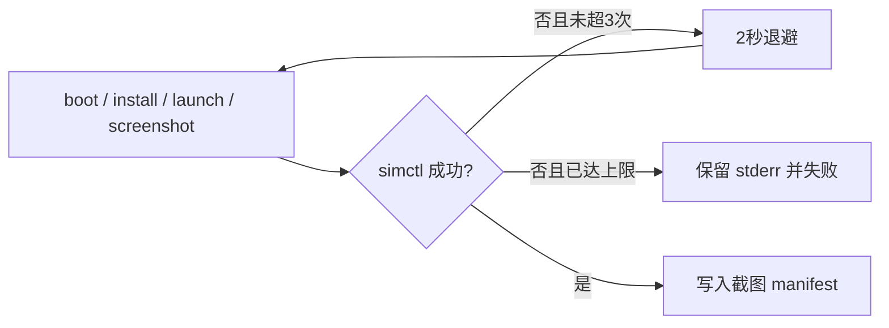

## v3.3.1 焦点测试宿主与同步生产边界

读图说明：首次 pending request 仍在挂载前设置，测试分别验证公开窗口生命周期和真实文本焦点；任何条件失败都会留下诊断并执行清理，生产逻辑没有延迟任务。

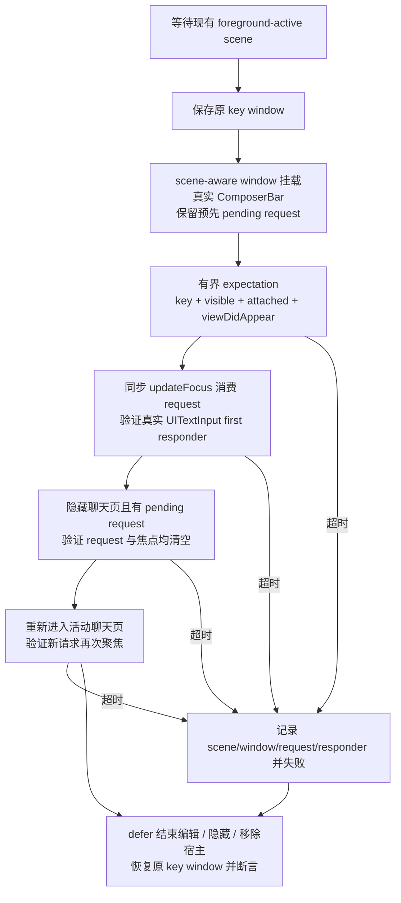

## v3.4 互斥呈现、自然高度与语义动作

读图说明：欢迎只选择可见子树，不改 seed 或会话数据；真实会话仍完整显示。布局和颜色都是本地只读呈现，readiness 高度由真实内容自然上报，不再让卡内 GeometryReader 固定高度造成越界。

```mermaid
flowchart TD
    %% 呈现决策只读既有输入，不删除默认消息
    Input[messages / isGenerating / hasStarter] --> Choice{有starter 且非生成且无user?}
    Choice -- 是 --> Welcome[顶部自然高度 welcome<br/>独立可见内容辅助摘要]
    Choice -- 否 --> Transcript[完整原数组 transcript<br/>UUID顺序不变 / 短会话bottom]
    Welcome -. 不改写 .-> State[会话 / seed / 标题 / 导出保持]
    Transcript -. 不改写 .-> State
    %% 会话工具基于实际剩余内容宽度，不新增根断点
    Width[SessionBar真实content width] --> Bar[288pt普通文字inline<br/>窄宽或大字stacked / 竖向sidebar]
    Bar --> Shared[单一sessionList + actions<br/>选择删除新建导出均保留44pt]
    %% panel只包裹真实自然高度
    Panel[设置页或dashboard panel外框] --> Content[扣两侧各14pt<br/>传真实content width]
    Content --> Card[354pt边界 / 原AnyLayout<br/>86slot和66ring / 自然报高]
    %% 风格映射与业务状态分离
    Theme[AppThemePalette] --> Actions[主次危险及prominent配对<br/>分类小面积tint]
    Theme --> Grid[静态40pt工程网格<br/>辅助显示偏好开启时移除装饰]
```

## v3.4.1 云端产物与真实宽度证据

读图说明：完整 XCTest 与 16 张模拟器截图仍是必选。v3.4 的 ImageRenderer 宽屏图缺正文而退回，改用公开 UIKit 宿主截图和标题 OCR；固定 viewport 图不声称 Mac GUI 已测。C 要同时读结构化结果、完整 xcresult 和实际图片，不能仅依赖 OCR。

```mermaid
flowchart TD
    %% 参考窗口先扣除生产全局侧栏，不能把root宽度冒充pane
    Root[1366x1024参考root] --> Global[生产root policy分配288pt sidebar]
    Global --> Pane[1078pt真实workspace pane<br/>chat再分会话栏与至少620pt阅读面]
    Pane --> Render[云端XCTest真实UIKit宿主<br/>drawHierarchy四工作区亮暗8图]
    Card[窄readiness大小字亮暗] --> Component[ImageRenderer仅测自然高度<br/>UIKit宿主组件截图4图]
    %% 原始附件和结构化结果来自同一个本轮xcresult
    Render --> OCR[Vision OCR识别已有页面标题<br/>缺正文不能仅靠尺寸通过]
    OCR --> Result[keepAlways PNG + JSON provenance<br/>LocalGemma-tests.xcresult]
    Component --> Result
    Result --> Export[公开xcresulttool导出<br/>summary / tests / 附件原索引]
    Export --> Manifest[校验12矩阵 / PNG尺寸hash / SHA-run-attempt<br/>OCR标记 + 同主题工作区hash不同]
    Export -- 失败 --> Failure[记录outcome并入visual失败<br/>仍生成manifest和JUnit]
    Screens[16张真实模拟器生产截图] --> Visual[现有必选visual阶段]
    Manifest --> Visual
    Visual --> Full[完整包保留三份xcresult]
    Visual --> Review[review小包辅助先读<br/>不是完整包替代]
    Full --> C[Agent C核对精确身份与结构化结果<br/>并实际看图决定PASS或退回]
    Review --> C
```

## v3.4.2 模型文件动作自然高度

读图说明：新宿主图揭示宽屏动作竖向拉伸，修复只收敛label高度，不改变模型文件或部署链。大字号继续自然增长，完整云端截图验证不取消。

```mermaid
flowchart TD
    %% 右列不能把空白高度注入左侧动作内容
    Pane[1078pt真实pane] --> Columns[生产模型双栏<br/>控制列 + 长详情列]
    Columns --> Panel[ArtifactActionPanel同一HStack]
    Panel --> Label[同一生产Button label<br/>移除竖向Spacer<br/>padding后fixedSize vertical]
    Label --> Height[图标标题副标题连续自然报高<br/>86pt minimum / 大字自然增长]
    %% 只测布局，不调用动作或写入状态
    Height --> Test[公开UIHostingController.sizeThatFits<br/>600/1400pt提议高度一致]
    Test --> Cloud[138项 + 28图 + 三份xcresult<br/>精确SHA云端验收]
    %% 已验收代码身份不冒充后续main文档提交
    Cloud --> Accepted[1601bd6 / run39825340832 attempt1<br/>呈现与布局回归限定PASS<br/>不是Mac GUI或发布验收]
    Label -. 不改变 .-> Boundary[44pt / metadata / 本地文件<br/>卸载确认 / runtime verified gate]
```

## v3.5 设置页双栏与自然回退

读图说明：设置页只使用根侧栏之后的真实pane，不建立第二套根断点；两块生产section在同一个shell中切换布局算法，状态与动作不变。宽屏图仍须实际复核，不以宽度断言替代人眼。

```mermaid
flowchart TD
    %% 根侧栏先分配，设置页再扣自己的padding
    Pane[真实workspace pane] --> Width[扣左右各18pt page padding]
    Width --> Choice{内容至少882pt<br/>且字号小于xxxLarge?}
    Choice -- 是 --> Columns[320pt偏好 + 24pt间距 + 运行计划<br/>运行列538至760pt / 整体最多1104pt]
    Choice -- 否 --> Stacked[同序单栏 / 最多760pt<br/>大字自然垂直增长]
    %% 两个直接子节点固定，只改变AnyLayout算法
    Columns --> Shell[同一个SettingsSectionsShell<br/>preferences + runtime身份保持]
    Stacked --> Shell
    Shell --> Preferences[相册binding / 导入中 / 错误仍归父级<br/>原主题与清除动作 / 44pt和metadata]
    Shell --> Runtime[真实运行列宽传给readiness与grid]
    %% panel内容宽度不能冒充外框宽度
    Runtime --> Grid[toggle扣28pt panel padding<br/>510pt内容阈值 / 指标350pt阈值]
    Grid --> State[原DeviceOptimizer状态流<br/>不启动runtime或联网]
    %% 所有执行只在云端，本机仅静态检查
    Shell --> Cloud[141项 + 16模拟器图 + 12宿主图<br/>三份xcresult / 精确SHA验收]
```


## v3.5.1 焦点宿主顺序

读图说明：首次request仍在挂载前存在，改变的是公开测试窗口的尺寸和就绪顺序；生产同步焦点不新增延迟。

```mermaid
flowchart TD
    %% 测试窗口先以真实场景尺寸接受焦点
    Scene[已有foreground scene] --> Key[真实bounds窗口 + container先key/visible]
    Key --> Mount[公开child containment挂载原ComposerBar
预存pending request仍在]
    %% 只观察生产同步焦点，不代替其设置first responder
    Mount --> Focus[同步onAppear消费request
严格观察真实UITextInput]
    Focus --> Lifecycle[离页清焦点和request / 重进再次聚焦]
    Lifecycle --> Cleanup[移除child和window / 恢复原key window]
    Cleanup --> Cloud[云端141项 + 三份xcresult + 28图复判]
```


## v3.5.2 模拟器正文门禁

读图说明：launch返回只代表系统接受请求，真实截图必须出现对应页面正文，避免把桌面或空白记为成功。

```mermaid
flowchart TD
    %% 独立验证CLI仅在真实云端编译
    Cloud[GitHub Actions] --> Tool[编译Vision截图验证CLI]
    Tool --> Launch[原App launch到指定工作区和主题]
    %% 每轮重新采集，最多五次，不降低marker要求
    Launch --> Shot[等待2秒 / 真实simctl截图]
    Shot --> OCR{目标正文marker被识别?}
    OCR -- 否且未满5次 --> Shot
    OCR -- 否且已满5次 --> Fail[必选visual失败 / 保留诊断]
    OCR -- 是 --> Manifest[识别全文 + marker + 次数 + 尺寸 + hash]
    Manifest --> Review[原16张矩阵 / 完整包人工看图复判]
```
